# GameBond

An experimental Windows connection-bonding client and Linux VPS server.
Stripes bulk traffic across IPv4 uplinks and duplicates selected traffic for resilience.

## Features

- Run as a VPN with one uplink; bond traffic when multiple uplinks are active (up to 8).
- All-app or selected-app capture, with application traffic profiles.
- Adaptive redundancy, link roles, speed limits, and usage caps.
- Dashboard and tray controls for connection health and app traffic.
- Connected devices: a console on a spare (USB) adapter gets its own bond address ([setup](docs/lan-devices.md)).
- Loss resilience: reorder buffer, TCP repair, parity FEC, adaptive duplication and loss steering.
- Fast failover: BFD path detection (500 ms), fast reroute, ECMP-style flow pinning.
- Queueing: per-flow fair queue with CoDel and ECN marking, DSCP classes.

The full list with config flags is in [FEATURES.md](FEATURES.md).

## Client

Windows, with ProxiFyre and the Windows Packet Filter driver. This is a source
checkout; there is no installer. Everything is Go (Go 1.25+); Python is not used.

```powershell
$env:GOFLAGS = "-buildvcs=false"
go -C native-edge build -o ../build/gamebond-native-client.exe ./cmd/client
go -C native-edge build -o ../build/gamebond-desktopctl.exe ./cmd/desktopctl
go -C native-edge build -ldflags "-H=windowsgui" -o ../build/gamebond-widget.exe ./cmd/tray
go -C netstack build -o ../build/gamebond-netstack.exe .
.\start-widget.cmd
```

Configure `configs/local-client.json` from [the example](configs/client.example.json).
Optional transport flags (`failover_replay`, `flow_pinning`, `codel`, `loss_tracking`, `delay_control`)
are described in [FEATURES.md](FEATURES.md); set the same ones on the server.
Choose **Connect** in the widget. Closing the window hides it in the tray;
**Quit (stop tunnel)** exits. `build\gamebond-desktopctl.exe status|ensure|connect|stop -root .`
controls the supervisor from a shell. Rebuild `desktopctl` and the widget whenever
config validation changes, because they embed the validators.

For several Starlinks, see [multiple uplinks](docs/multiple-uplinks.md).
For a PS5, laptop or phone behind a USB adapter or a Wi-Fi access point on it,
see [connected devices](docs/lan-devices.md).

## Desktop walkthrough

Start the widget with `start-widget.cmd`. The status strip at the top shows each
uplink (adapter, address, live rates, Starlink dish and Wi-Fi signal where
available) and a chip for every connected device. The **Connect/Disconnect**
button starts and stops the tunnel. The footer shows the exit server and link count.

**Traffic Monitor** is the home page. It graphs live adapter traffic (or VPN-only
counters) per application or for everything, over a selectable window.

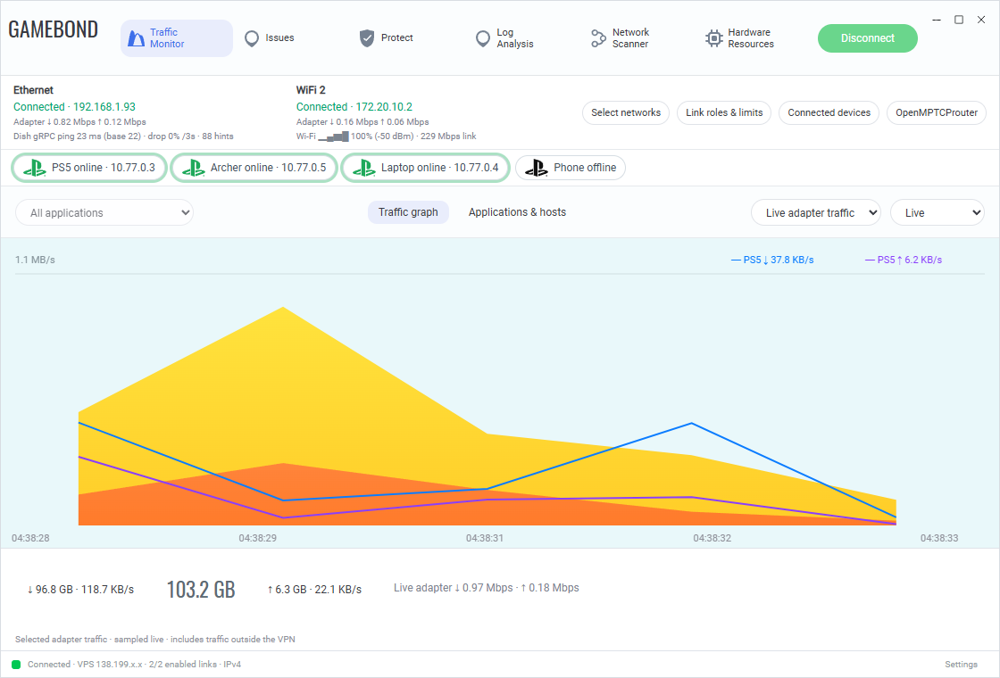

**Applications & hosts** lists what each app is talking to.

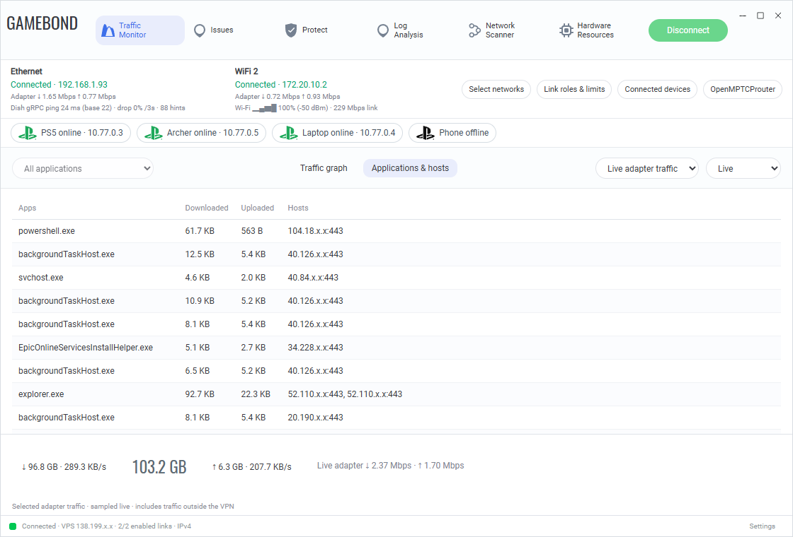

**Issues** is the health page: per-link loss, jitter and RTT, packets the receiver
gave up on, bursts and stalls, and the PS5 gateway probe loss. Start here when a
game feels bad.

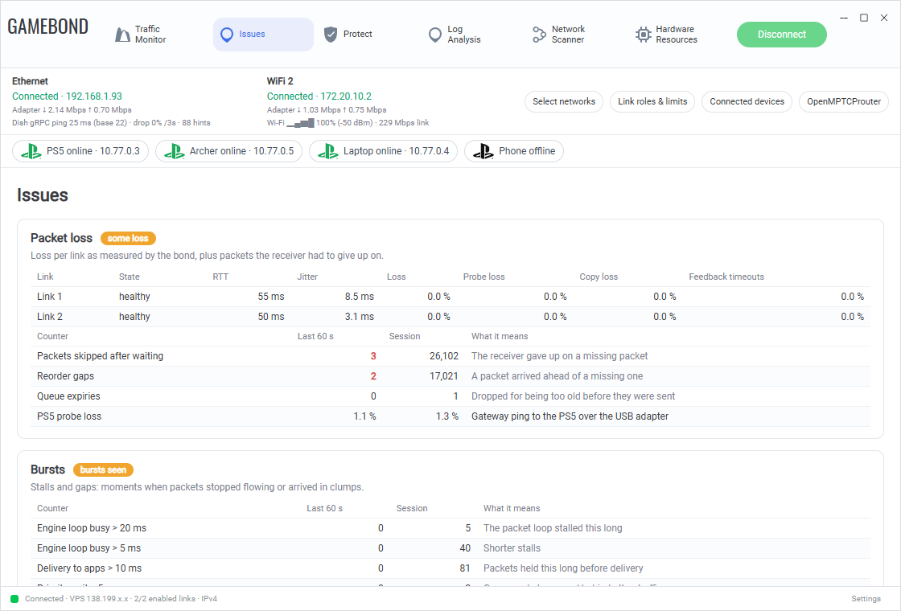

**Protect** controls which applications use the tunnel. All traffic is included by
default (unverified applications are allowed). Per app you can allow or block, set a
traffic profile, and see hosts and rates.

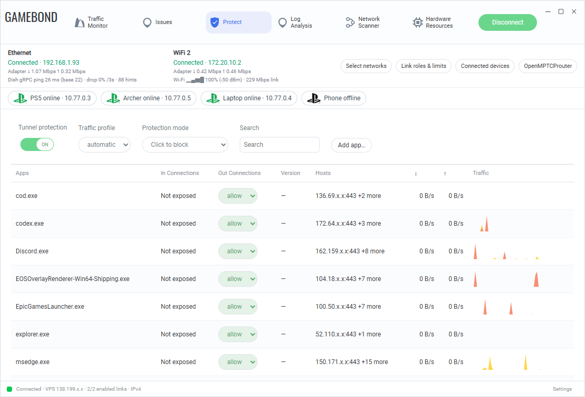

**Log Analysis** is the event journal: connection changes and first-seen apps, with
filters and read markers.

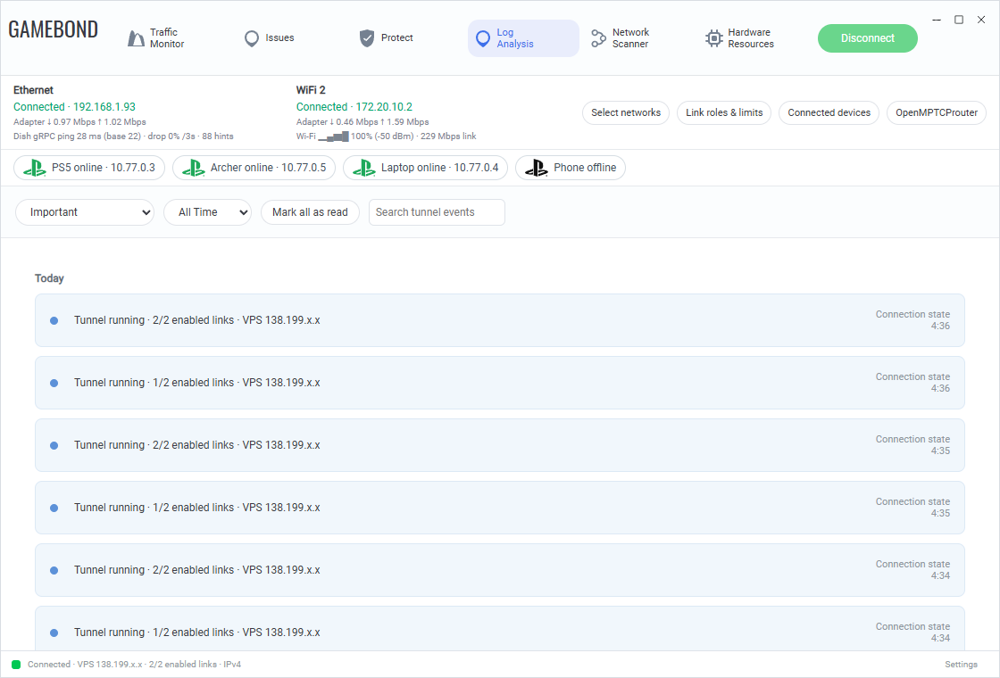

**Network Scanner** reads the local neighbour cache per adapter and can run a
bounded ICMP scan of a private subnet. It never probes without being asked.

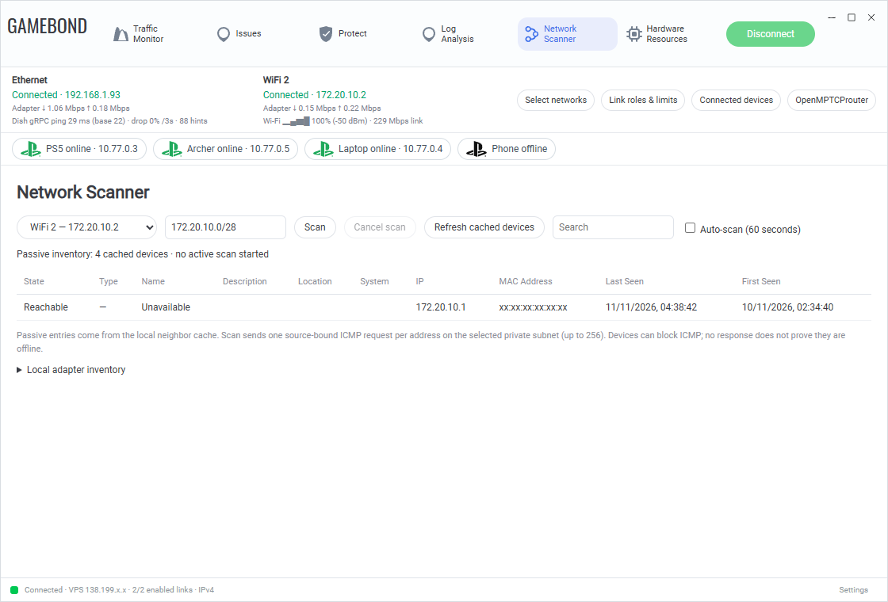

**Hardware Resources** shows CPU, memory, GPU and network load on the PC.

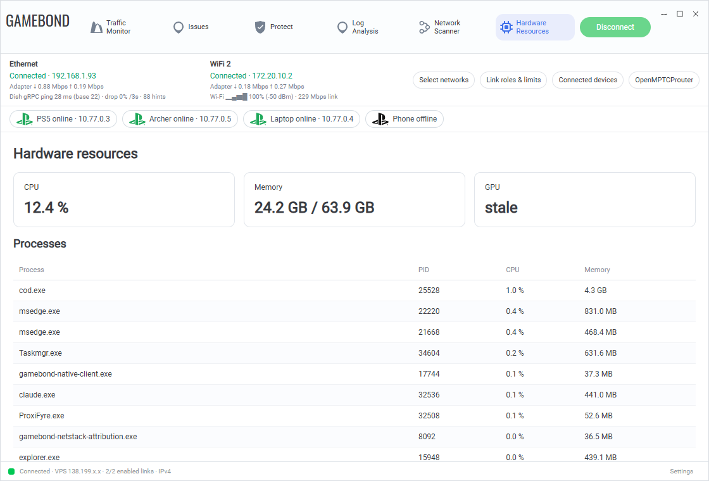

The buttons under the uplink strip open dialogs:

- **Select networks** chooses which adapters are bonded (1 to 8).

  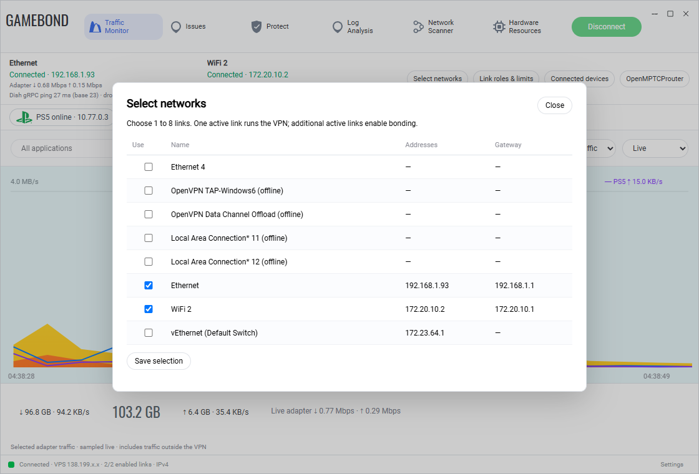

- **Link roles & limits** sets each link's role (primary, secondary, backup, never),
  speed limits and daily/monthly caps.

  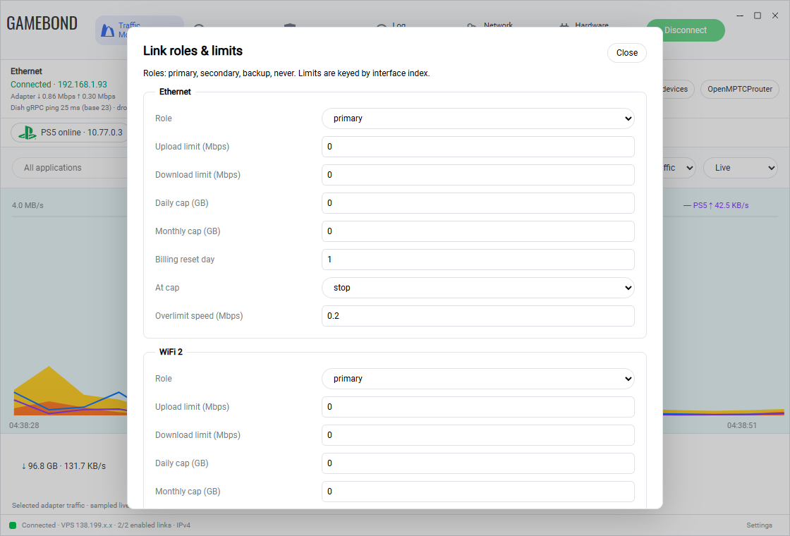

- **Connected devices** gives a console, laptop or phone its own bond address. Several
  devices can share one adapter, for example a router in access-point mode on a
  USB Ethernet adapter. See [lan-devices.md](docs/lan-devices.md).

  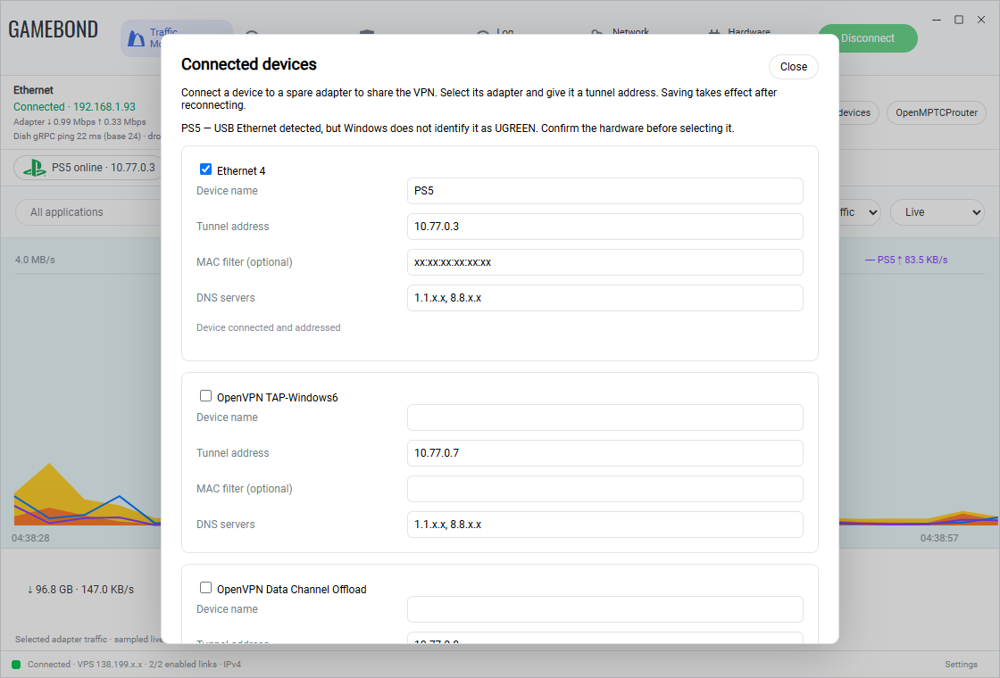

- **OpenMPTCProuter** optionally sends non-game traffic through an OMR server.

  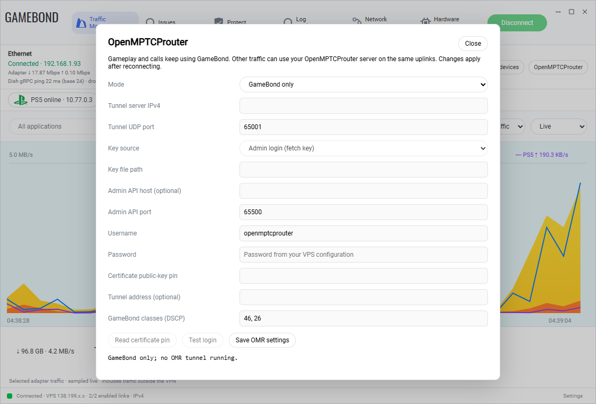

Screenshots mask public IP and MAC addresses.

## Server

Requires Linux, Docker Compose, and `/dev/net/tun`.

1. Copy [the server example](configs/server.example.json) to `configs/local-server.json`.
2. Create a 32-byte key: `head -c 32 /dev/urandom > secrets/gamebond.key`.
3. Configure matching keys, session IDs, and bonding settings on both endpoints.
4. Set `GAMEBOND_SERVER_CONFIG=./configs/local-server.json` and
   `GAMEBOND_KEY_FILE=./secrets/gamebond.key` in `deploy.env`.

```sh
docker compose --env-file deploy.env up -d --build
docker compose --env-file deploy.env logs --tail 30
```

The Go edge owns TUN/NAT inside its container and publishes UDP 4433. Addresses
for attached LAN devices go in the server config as `lan_tunnel_ips`.
Keep keys and live configs private. Server restarts require matching session handling.

An optional HTTPS admin portal (status, config editing, restart) is described in [admin-portal.md](docs/admin-portal.md).

## Fragmentation and the 1280 MTU (read this before debugging game loss)

The tunnel MTU is 1280. Internet hosts, game servers in particular, send
packets of 1280-1500 bytes with the Don't Fragment (DF) bit set. A Linux router
must drop those instead of fragmenting them, and returns an ICMP "fragmentation
needed" that games ignore. The result is silent loss of exactly the big packets:
hits, kills and kill-cam data.

What we saw (2026-11-10, COD on a PS5 through the tunnel):
- In-game packet loss of 12-33% when getting hit, while movement was fine.
- Every tunnel counter showed 0% loss, so the loss was invisible on the legs.
- About 18% of inbound game packets were over 1280 bytes with DF set. The server
  sent ICMP type 3 code 4 to the game servers at its rate limit of 1/s each.
- Going direct (`udp_direct`) had no loss because nothing there is limited to 1280.
- Time was lost on queue limits, classifier tags, reorder timers and the exit route.
  None of them was the cause.

Fix: the container entrypoint (`tools/container-entrypoint.sh`) adds an nft
chain `ip gamebond defrag` that clears DF on inbound packets over 1280 bytes. The
kernel then fragments them to fit the tunnel and the PS5 reassembles them.
Every server image must use this entrypoint. If you swap the base image, keep
the rule, and check that it survived with:

```sh
docker exec <container> nft list chain ip gamebond defrag
```

How to check for the problem in about a minute: on the server, capture inbound
UDP on the public interface and count packets with total length over 1280 and
DF set. Also count outbound ICMP type 3 code 4. Both should be zero on a
healthy server. Pings to game servers tell you nothing, because they do not
answer ICMP.

The client's LAN gateway fragments oversized device packets without DF, and
sends ICMP frag-needed for DF ones. Watch `oversize_fragmented` and
`oversize_df_dropped` in the status file.

## Development

```powershell
$env:GOFLAGS = "-buildvcs=false"
go -C netstack test ./...
go -C native-edge test ./...
```

- [netstack/](netstack/): Windows userspace proxy.
- [native-edge/](native-edge/): the Go client, server edge, widget and tools.
- [native-edge/testdata-gen/](native-edge/testdata-gen/): frozen Python scripts that generated the test vectors. Python is not needed to run the tests.
- [tools/](tools/): container entrypoint, deploy and diagnostic scripts.

The Python implementation was retired; it remains in git history.
GameBond uses its own protocol and does not interoperate with Speedify.

## Changelog

Newest first. The client has no version tags: it reports the git commit it was built from, and the server reports its own
(shown in the footer). Each entry was written from the diffs of the commits listed. Add an entry under **Unreleased**
with every change that alters behaviour and give it the commit once it is committed. Changes to the shared bonded
transport are in the [GameBond.Core](https://github.com/Dankular/GameBond.Core) changelog and the server's are in
[GameBond.Server](https://github.com/Dankular/GameBond.Server); this one records what the client picks up from them.

### Unreleased

**Metrics, alerting and measured-loss reporting**
- **`slo_probe`** sends an ICMP echo through the tunnel to the server (`slo_target`, default 10.77.0.1) every `slo_probe_ms` (default 1000) and measures what really comes back: a probe not answered within 1 s is lost, charged to the minute it was sent. Results are kept per minute in `slo.db` (SQLite, WAL, 35-day retention) with an RTT histogram, and judged against objectives (delivery 99.99%, availability 99.95% of seconds, latency 99% at or under 150 ms, failover p95 5 s) with burn rates over 1 h, 6 h, 24 h, 7 d and 30 d and a 95% upper bound on loss. The status document gains an `slo` section.
- **`metrics_addr`** (loopback only) serves Prometheus text at `/metrics`: path, receive, send, queue, outage, exit, health-alarm, probe and SLO series, all named `gamebond_*`. `ops/prometheus/` holds the alert rules (a test checks every metric they name is really exported), a Prometheus config and an Alertmanager example.
- **The tray raises Windows notifications** for no connection, reduced redundancy, exit server silent or changed, transport alarms and a delivery objective at risk. Each is raised once after it has held for a set time and followed by a recovery notice.
- **The topology map shows traffic per exit server** (rate and total, kept per exit across failovers) and every connection animates in the direction of its traffic: moving dashes, a pulsing glow and a halo that grow with the rate. The glow eases toward each new level (quickly up, slowly down) so throughput spikes fade in and out instead of jumping. Needs the daemon restarted to report exit traffic.

### Failover (working tree, not committed)

**Backup exit server with automatic failover (built and deployed to this PC)**
- **`peer_backups`** in the client config lists up to three standby exit servers, each `[host, port]`; `peer` stays the
  primary. `exit_failover_ms` (500 to 60000, default 2000) is how long the active server may be silent before the client
  looks for a standby. Both are validated when the config is loaded or saved (`appconfig`), and the backups cannot be
  combined with the stream carrier (`outer_transport`).
- **The active server is judged by authenticated frames arriving from it.** BFD and supervision frames flow every few tens
  of milliseconds even when idle, so silence means the server or the way to it is gone.
- **Silence alone does not switch.** A local outage (both links down for a few seconds) looks the same, and a switch resets
  every bonded TCP stream. While the active server is silent the client sends real handshakes to the standbys over the live
  uplinks and moves only to one that answers; if none answers, nothing is switched. The standby that answered is promoted
  with the handshake it just finished, so no traffic waits for a second one.
- **Standbys are probed while the active server is healthy** (first after 5 s, then every 30 s; a probe is one handshake per
  live uplink and is dropped at once) so a standby that stopped working is shown before it is needed.
- **Sticky, no automatic failback.** After a switch the client stays on the new server until that one goes silent; the old
  primary is then probed like any standby. A switch resets TCP streams terminated at the exit and changes the public IP.
  The outage journal records the switch (`exit-node`), but its in-memory counters start again on the new session.
- **Status and GUI.** `userspace-status.json` gains `exit` (active, primary, `on_backup`, per-server state, last probe and
  handshake time, failures, switches, last reason), `peer` now names the active server, and the Topology map shows the
  active exit as primary or backup with each standby underneath (reachable with its handshake time, no answer, or not probed).
- **Tests:** a loopback pair of servers where the active one is killed and the session moves and carries traffic; a pair
  where both die (no switch, search state shown); the idle probe leaves the session where it is; config validation.
- **Measured on this PC:** the standby at `195.154.119.136:4433` completed a handshake over the live links in 75 ms while
  the primary stayed active. A live failover drill has not been run: it would reset the connections in use.
- **Backup host.** `195.154.119.136` (the former exit) runs the same server image, key and config as the primary under
  `/opt/gamebond/releases/native-live`, on UDP 4433 because 4434 belongs to an unrelated older container there. The
  update probe is not watching it, so it stays on the image it was started with until it is updated by hand.

### 2026-11-13, topology, device usage, dark mode and Core v0.1.17

**Dark mode**
- A footer button cycles Auto, Light and Dark. Auto follows the Windows theme and changes live; the choice is kept in
  `localStorage` (guarded, the page works without it). New: `native-edge/dashboard/widget_theme.js`. Covers the header, tabs, toolbars,
  tables, dialogs, the traffic graph, issue and journal cards and the topology. Not covered: the status pills under the toolbar stay light.

**Network Topology tab and per-device usage**
- **Network Scanner has two views, Devices and Topology.** Devices is the existing list. Topology draws the exit
  server, each bonded link with its live in/out rate, RTT and health, this PC, and every device behind it, under a
  headline that reads "Everything is great!" or names the link that is down. A row of counters shows links up, routed
  devices, other LAN devices and the wire rate in and out. New: `native-edge/dashboard/widget_topology.js`.
- **Devices that share one physical adapter hang off an adapter node** that shows the combined rate through it (an access point
  and the devices connected to it). Clicking the node shows combined gauges and a table of every device behind it. Found because the
  Archer's own address carries almost nothing while the PS5 and Laptop behind it carry the traffic.
- **Click a device for its card.** Details (tunnel IP, device and adapter MAC, DHCP lease, last frame, problem, first
  and last traffic), a current-usage summary with download and upload gauges against the peak, a donut and list of apps
  and services, a ports table (protocol, remote port, service, bytes each way, packets), the top remote hosts, and a
  1 h, 6 h or 24 h history chart.
- **Only devices that route through the tunnel have measured usage.** A device on the local network that never uses a
  GameBond LAN adapter is listed with a "traffic not visible" notice instead of invented numbers; there is no packet
  capture of the LAN. Services are inferred from the remote port (HTTPS, QUIC, DNS, Xbox / Call of Duty, PlayStation, Steam
  and others), not by inspecting the traffic.
- **`devusage` package** (`native-edge/devusage`) accounts each routed device's bytes and packets per protocol and remote port
  and per remote host, a live rate over 5 s windows with a peak, and a per-minute history for 24 h. The port table is bounded
  to 64 entries and the host table to 256 per device. `lanManager` records every packet in `OnPacket` (device to tunnel) and
  `dispatch` (tunnel to device) and the status file gains a `device_usage` object keyed by tunnel IP, with the history as
  compact `[unix, up bytes, down bytes]` triples. Totals and history are saved to `.runtime/device-usage.json` once a minute and
  loaded at start; entries older than 24 h are dropped. The port, host and live-rate tables start empty after a restart.
- Tests: `devusage` (breakdown, rate going to zero when quiet, per-minute history save, load and expiry, junk and fragments,
  bounded port table) and `TestWidgetScriptParses` now covers the topology script.

**Core v0.1.10 to v0.1.17**
- Pinned in `native-edge/go.mod` (from v0.1.10) and `netstack/go.mod` (from v0.1.6). What changes on the wire and in the receive path:
  loss feedback is sent the moment a gap is seen; the selective-ack bitmap is now actually sent by the receiver; supervision
  frames keep their cadence through bursts; BFD counts any authenticated frame as hearing the peer, so a loaded line is not
  declared down by lost BFD frames; redundancy copies still go to a BFD-down line; stream ack processing no longer walks the
  whole history; the stream delay shrink is gentler with 4 MiB windows; striping only runs while every path is calm. See the
  Core changelog for v0.1.11 to v0.1.17.
- Not yet pinned: Core `7fa3202`, BFD detecting a dead line in 150 ms instead of 500 ms. It is committed locally in Core, not
  tagged, not deployed and not measured on the live link.

### 2026-11-12 (later), commits `ca077d6` to `c78a806`
- `60cd93a` **Network access.** Devices that are not configured can ask for an address. A DHCP request from an unknown MAC is
  checked against the block list and then the mode: closed (ignored but listed), ask (a banner and dialog in the GUI) or auto
  (accepted at once). Accepted devices become gateways without a restart. Lists live in `lan-access.json`, pending requests in
  `lan-pending.json`. New: `lan/access.go`, `cmd/client/lanaccess.go`, `dashboard/lan_access.go`, 825 lines in total.
- `61b2214` **`stripe_above_mbps` client config.** Passed to the sender, so a bulk flow above that sustained rate is striped
  across the links instead of duplicated. Core v0.1.8; `ca077d6`, `f597073` and `c78a806` bring Core v0.1.7, v0.1.9 and v0.1.10.

### 2026-11-12 (00:09 to 06:06), commits `5931aa0` to `ba68495`
- `ba68495`, `c9ee0a9` **PRP and HSR RedBox on LAN devices.** A device with a second adapter (`redundant_interface_*`) is attached
  through a RedBox over both: PRP (two parallel LANs, RCT trailer) or HSR (ring ends, HSR tag, forwarding to the opposite port,
  duplicates discarded on source and sequence). The status file gains per-path FRER data: which path delivered first, how far
  behind the second copy lands and what the peer reports about its own paths.
- `cb98664` Core v0.1.6. `f937a50` **netstack** gets a buffered stdin reader, GC, timer and priority tuning and builds against
  Core's stream; the deploy script builds and swaps it.
- `341f363` Timing is recorded for tunnel-to-app delivery (stack pipe writes, LAN gateway lock and adapter writes).
- `e6909a8` Core v0.1.4, a 1 ms Windows timer, above-normal process priority and GC tuning. `64f96e6` Go runtime GC pause and
  scheduler latency in the status file.
- `4445ae2`, `b175833` **Split into three repos.** The server and the shared code (`bond`, `stream`, `buildinfo`, `hwmon`)
  move to GameBond.Server and GameBond.Core; the client depends on Core v0.1.0 and then takes v0.1.1 to v0.1.3 (`5442908`,
  `65976fc`, `6ebf001`).
- `f20a84a` **Edge node health.** The server announces planned restarts, and the widget shows up, updating, degraded or down.
  `3896713` refreshes the server version every 5 s.
- `b59c17c` Client and server versions are shown in the UI (the build commit is exchanged over the tunnel).
- `b527370`, `23cbbb4`, `998fbf9`, `fbb1052` **Server update probe and deploy.** The VPS watches the image workflow, pulls and
  swaps the container and rolls back if it does not come up; deploy runs the update detached with short polling sessions and
  waits for the old widget to exit before replacing its executable. `ce1d786`, `624c0c0`, `1e50711`, `b0fd710`, `5fb478c`: the
  server image is built by GitHub Actions on every push and pulled from GHCR; steps run in parallel; the client skips unchanged
  builds; leftovers are killed at once.
- `340129f` **Outage journal.** A timestamped record of every moment a line stopped or resumed carrying traffic, with the cause,
  and of every full outage. Memory is fixed (a ring of recent events, totals and one counter per minute for a day), recording
  never blocks the packet loop, and the durable log drops and counts events rather than wait. Also driver health and the
  loss panel in the widget.
- `3091b76` Dashboard "Loss and redundancy" panel: duplication, packets truly lost, recovery counters and per-link BFD.
- `5931aa0` Paths that BFD reports down are skipped; the BFD hold-down is adaptive (short the first time, doubling for each
  failure inside a flap window); the set of paths a copy should arrive on is rebuilt periodically instead of for every packet.

### 2026-11-11, commits `f075a09` to `41fa335`
- `41fa335` **Every packet is duplicated by default and the protection presets are gone.** With two or more ready paths each
  packet goes on a second path from the first packet on, with no loss or delay condition to wait for; the first copy wins.
  A frame is called overdue only after a round trip plus a measured feedback gap, with no fixed floor.
- `1870b35` **Selective-acknowledgement loss detection.** The sender calls a frame lost when later frames on the same path
  arrived without it and answers from the stored payload; tail probes; Reed-Solomon parity rows with staggered sends;
  loss causes in the status file; 8 MiB uplink buffers.
- `869b37a`, `9ec6d78`, `20e75e6` Copies are tracked in the line budget so their feedback is accepted but they are not window
  data; larger live windows (8 MiB, 16384 packets); TCP repair, early cover and a DHCP lease table that survives restarts.
- `c33a724`, `8973761` An automatic protection preset (parity for TCP data, copies for small packets) that escalated to full
  copies on repair requests or delay spikes. Removed the same day by `41fa335`.
- `3bca25a` Rate-controller simulation, health alarms, a metrics recorder (`metrics.jsonl`), ACK-stall detection and
  predicted-arrival scheduling.
- `c580f86` **BFD** (both ends must hear each other, one-way failures found by both ends), **flow pinning with fast reroute**,
  **per-flow CoDel**, XOR parity and `FEATURES.md`.
- `972b22c` The Python implementation is retired: Go-only Dockerfile and entrypoint, README walkthrough with screenshots,
  DNS tab removed from the widget. `f075a09` A shared LAN adapter (a router in access-point mode), DNS code removed, unverified
  applications allowed.

### 2026-11-10, commits `b00d2a0` to `28292f1`
- `b00d2a0` **Game packet loss from the 1280 MTU.** UDP passthrough and Starlink dish hints; a per-flow deficit-round-robin fair queue
  for bulk traffic (`fairqueue.go`, 156 lines); a delay-based rate reduction when a standing queue builds that loss never signals;
  the admin portal reads hardware from a background cache instead of sampling in the HTTP handler. `770146b` restricts the
  don't-fragment clear rule to inbound UDP over 1280 bytes. See "Fragmentation and the 1280 MTU" above.
- `28292f1` `delay_assertive`: cut a path's rate on modest standing queues under TCP-limited bulk.
- `0423bbb` Issues tab, Starlink gRPC and Wi-Fi metrics, ProxiFyre supervision (orphan cleanup), asynchronous delivery.
- `b0f0cc6`, `3f605bc`, `24ed2ac` The classifier crashed when a console and PC capture both fed it, so `Bridge.outbound` is
  serialised; the PlayStation status chip (green online, amber problems, black offline), console lines in the graph and
  disconnect on power-off.

### 2026-11-09, commits `a235d14` to `625fbd1` (125 commits)
- **Port from Python to Go.** Each Python module was ported with vectors generated from the Python original and compared:
  the wire protocol (kinds 13-17, path MTU discovery, link policy, failover replay, loss tracking and copy scoring), `uplink`
  (per-adapter UDP sockets with don't-fragment), `client`, `stackio`, `lan` gateway, `nat`, `router`, `carrier` stream
  fallback, `omr` and Glorytun mud client, `dns`, `scanner`, `appconfig`, `apppolicy`, `appauth`, `appevents`, `atomicio`,
  `pktfilter`, `hwmon`, `adminauth`, `adminportal`, `ttyrelay`, `launcher` supervisor, `procjob` and the tray agent. A
  parity ledger (`docs/go-migration-ledger.md`) recorded the cutover criteria and each measured result.
- `625fbd1` The desktop VPN starts from a persistent launch profile (`configs/desktop.example.json`, `desktopctl`).
  The widget, network discovery, adapter selection, transport settings, UGREEN PS5 adapter discovery, persisted event history
  and application policies were restored in the Go widget (`7ca5f2a`, `9d49ef6`, `f082972`, `fffa5ab`, `8678ee2`).
- `a235d14` A console on a spare USB adapter can join the bond with its own address.

### 2026-11-03 to 2026-11-05, commits `af059ea` to `81b309a`
- `af059ea` Initial GameBond client and server in Python, with connection stability fixes (1,162 files, 73,917 lines).
- `81b309a` Bonding of two to eight uplinks with dynamic network selection; `4d75a0a` the dashboard stays responsive during
  telemetry updates.
