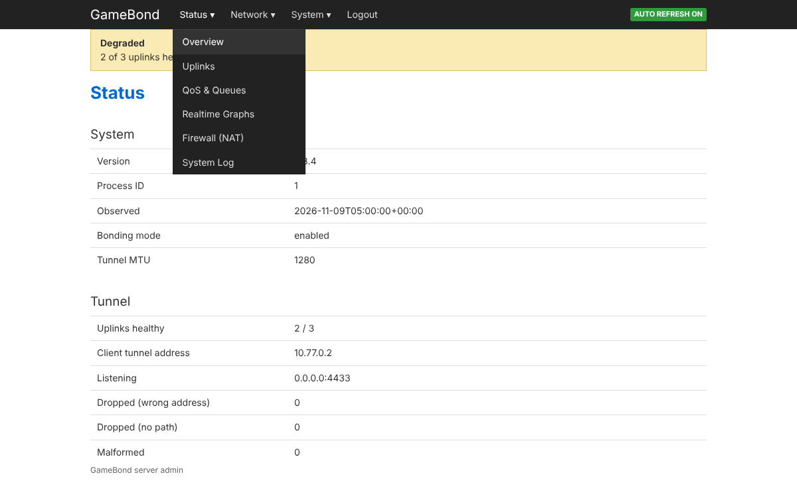

# Admin portal

A web portal inside the Python server process for viewing and managing the
GameBond server. Layout follows OpenWrt's LuCI ([reference](reference/openwrt/README.md)).
Stdlib only; the native Go edge (`GAMEBOND_NATIVE_EDGE=1`) is not supported and
the container refuses that combination.



## Setup

```sh
python -m gamebond admin-cert secrets/admin --host vps.example.com   # self-signed; use a CA cert for real use
printf '%s' 'a long password' | python -m gamebond admin-passwd      # prints password_hash
```

Add to the server config, with the hash from above (paths are inside the container):

```json
"admin": {
  "bind": ["0.0.0.0", 8443],
  "password_hash": "scrypt$32768$...",
  "tls_cert": "/run/secrets/admin/admin.crt",
  "tls_key": "/run/secrets/admin/admin.key"
}
```

Compose publishes `8443/tcp` (`GAMEBOND_ADMIN_PUBLISH`, default all interfaces) and mounts
`GAMEBOND_ADMIN_TLS_DIR` (default `./secrets/admin`, which **must exist** now). To keep it private,
set `GAMEBOND_ADMIN_PUBLISH=127.0.0.1:8443` and use an SSH tunnel. Without an `admin`
block nothing listens.

## Pages

Status: Overview, Uplinks, QoS & Queues, Realtime Graphs, Firewall (NAT), System Log.
Network: Interfaces, Connected Devices, Routing. System: Configuration, Administration, Restart Service.

## Security model (implemented and tested)

- scrypt password hash; sessions are random tokens in `HttpOnly; Secure; SameSite=Strict`
  cookies (30 min idle, 8 h absolute, max 16); every POST needs the per-session `X-CSRF-Token`.
- Failed logins are throttled per address (exponential) and globally. Behind a reverse proxy
  or NAT all clients share one address, so the throttle is only as fine as the source address seen.
- Strict CSP (no inline script/style), `no-store`, HSTS. Non-loopback bind without TLS is refused at config load.
- Changing the password ends all sessions. The `admin` block cannot be edited in the config editor.

## Restart and config saving

- **Save** validates with the same `load_config` as startup, then writes the file in place
  (the compose bind mount is now writable). The previous text is kept at `/tmp/gamebond-config.previous.json`
  inside the container (tmpfs; lost when the container stops). Saving does not apply anything.
- **Restart** makes `gamebond run` exit with status 75; the container entrypoint re-validates the
  config, rebuilds the NAT table and subnet, and relaunches. No Docker socket is used. If the saved
  config fails the entrypoint's checks, the container exits (and `restart: "no"` leaves it down).
  Tunnel traffic drops during the restart; whether clients resume cleanly depends on GB03 session
  handling and was **not tested against a real client**.

## Not verified / limits

- The entrypoint restart loop was syntax-checked (`bash -n`) only; it was not run in Docker here.
- `ip` and `nft` pages need those tools in the container; both are installed by the Dockerfile but were
  not run in a container here (the tests do not exercise them).
- Connected Devices lists configured addresses only; the server keeps no per-device counters.
- System Log holds portal events and a health sample every 5 s, not the process's stdout.
- Public exposure of a root-adjacent admin surface (NET_ADMIN container, writable config) is your
  risk decision; a self-signed certificate gives no protection against interception until pinned.
